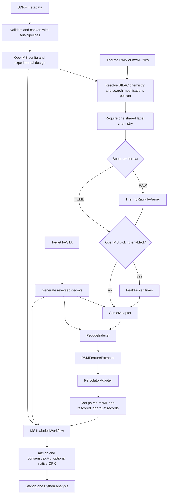

# OpenMS SILAC Nextflow prototype

This repository runs OpenMS-based DDA identification and MS1-labeled SILAC
quantification with Nextflow DSL2. It migrates an existing Bash prototype into
small processes and provides standalone Python tools for inspecting completed
runs, evaluating known mixtures, and analyzing explicitly defined biological
contrasts. The longer-term aim is integration of the SILAC-specific work into
quantms.

The default OpenMS image is now the pinned **3.7 development build**, revision
`842adef`. Fresh local E. coli duplex and triplex runs completed through the
whole pipeline with that image and increased quantification coverage over
the previous 3.6 build. The earlier native-idparquet migration reproduced the
checked idXML outputs using the old image; the subsequent OpenMS upgrade
intentionally changes scientific behavior. Broader validation is ongoing:
successful execution does not establish quantitative accuracy for every dataset.

The implementation and upgrade evidence were reviewed on **2026-10-20**.
The immediate priority is fine-tuning processing tools to improve coverage
while monitoring known-mixture accuracy. Further QPX validation, downstream
analysis improvements, and PTM localization follow that work. See the
[current status report](docs/NF_SILAC_OpenMS_Upgrade_Status_2026-10-20.md).
Historical dataset checkpoints below retain their stated dates. Local
spectra, metadata, results, and reports are not all distributed with Git.

## Contents

- [What the workflow does](#what-the-workflow-does)
- [Requirements and setup](#requirements-and-setup)
- [Run the workflow](#run-the-workflow)
- [Datasets and their scientific questions](#datasets-and-their-scientific-questions)
- [Analyze completed runs](#analyze-completed-runs)
- [Choose an analysis method](#choose-an-analysis-method)
- [Read and interpret the results](#read-and-interpret-the-results)
- [Add a new dataset](#add-a-new-dataset)
- [Native identification format and validation](#native-identification-format-and-validation)
- [OpenMS upgrade and next steps](#openms-upgrade-and-next-steps)
- [Native QPX output](#native-qpx-output)
- [Verification and troubleshooting](#verification-and-troubleshooting)
- [Repository layout and implementation limits](#repository-layout-and-implementation-limits)

## What the workflow does



The active steps are:

1. Validate the SDRF and convert it into a per-file OpenMS configuration table
   and a separate experimental design containing fractions, channels, samples,
   and condition annotations.
2. Resolve the isotope chemistry and add the SILAC modifications and binary
   modification groups needed by Comet. The chemistry is supplied explicitly
   through [assets/silac_chemistry.json](assets/silac_chemistry.json). Channel
   names (light/medium/heavy) come from the SDRF `comment[label]`. SILAC labels
   that the SDRF lists as variable modifications are searched only in their
   binary group and must match the chemistry; labels annotated as fixed
   modifications are rejected.
3. Convert Thermo RAW inputs to mzML when requested, using native Thermo
   centroiding by default. Supplied mzML files pass through unchanged unless
   `--openms_peakpicking true` enables `PeakPickerHiRes` before identification.
4. Generate a combined target-decoy FASTA, search with Comet, index peptides,
   extract PSM features, and rescore each run with Percolator. All four
   identification processes write native `.idparquet` directory bundles.
5. Keep spectral files paired with their rescored bundles and sort complete
   run records by `meta.id`, then invoke
   OpenMS `MS1LabeledWorkflow` once for the experiment, with the design and
   configured reference channel, protein FDR, fraction aggregation, and ratios.
6. Publish scientific outputs. Run the Python analysis separately; it is not
   automatically called by Nextflow.

Spectrum preparation follows the quantms convention: native Thermo centroiding
during RAW conversion, with standalone OpenMS picking disabled by default.
ThermoRawFileParser uses its default native peak picking during conversion.
`openms_peakpicking` enables the OpenMS step for both converted and supplied
mzML files.

| Input / route | Parameters |
| --- | --- |
| Thermo RAW, native centroiding | Default: `--openms_peakpicking false` |
| Already centroided mzML | `--openms_peakpicking false` |
| High-resolution profile mzML | `--openms_peakpicking true` |

`--peakpicking_ms_levels 2` restricts the enabled OpenMS step to MS2; leaving
it unset uses OpenMS automatic detection. This parameter does not configure
Thermo-native centroiding. In automatic mode, OpenMS skips centroided spectra;
explicitly selecting an already centroided MS level can fail. Choose the
preparation route to suit the input representation and instrument resolution.

The `test_duplex` and `test_triplex` profiles explicitly enable OpenMS picking
for their profile mzML fixtures. Command-line arguments override that setting.
To repeat the duplex comparison:

```bash
nextflow run . -profile docker,test_duplex \
    --outdir results/ms_levels_experiment/duplex_auto -resume

nextflow run . -profile docker,test_duplex \
    --peakpicking_ms_levels 2 \
    --outdir results/ms_levels_experiment/duplex_ms2_only -resume
```

The active workflow accepts **one compatible SILAC chemistry per invocation**.
A mixture of duplex and triplex runs is rejected. Historical cohort outputs
can be analyzed, but automatic cohort splitting is not connected to the
current Nextflow workflow. Separate cohort calls also mean separate protein
inference and quantification.

## Requirements and setup

For processing, use Nextflow **25.10.0 or newer**, a Java runtime compatible
with your Nextflow installation, and Docker access. Every active process has
an assigned container; enable them with `-profile docker`. Without that
profile, the corresponding executables must be installed locally.

| Task | Container selected by the current configuration |
| --- | --- |
| SDRF validation/conversion | `openms-silac/sdrf-pipelines:dea8ba9-procps` |
| SILAC configuration resolution | `openms-silac/python:3.11-procps` |
| Thermo RAW conversion | `quay.io/biocontainers/thermorawfileparser:1.4.5--h05cac1d_1` |
| OpenMS, Comet, and Percolator processes | `ghcr.io/openms/openms-tools-thirdparty@sha256:734197c186b23a98bdb5cb25071d28e10b125480f8d67d8aa59c76c3632c5ac0` |

Build the two local helper images from the repository root:

```bash
docker build -f containers/sdrf-pipelines.Dockerfile \
    -t openms-silac/sdrf-pipelines:dea8ba9-procps containers

docker build -f containers/python.Dockerfile \
    -t openms-silac/python:3.11-procps containers
```

The SDRF Dockerfile **requires the existing base image**
`openms-silac/sdrf-pipelines:dea8ba9`. This repository contains the derived
image recipe, not a recipe to build that base image from scratch. Both helper
recipes add `procps` for Nextflow execution monitoring. The OpenMS image is
pinned by digest and reports `3.7.0-pre-HEAD-2026-10-19`, revision `842adef`,
built on October 20. This is a development build, not a stable 3.7 release.
Other images still use tags; record their digests when freezing a benchmark.

Standalone analysis needs Python **3.10 or newer**. Matplotlib is optional for
plots; SciPy is optional for configured biological tests. The local `silac`
Conda environment can be used for analysis:

```bash
conda activate silac
python bin/analyze_completed_run.py --help
```

The analysis scripts do not install packages. `--no-plots` generates the main
report and tables without Matplotlib; absent SciPy leaves effect estimates
available but marks eligible tests as unavailable. Host Conda activation is
not required for processing tools when all tasks run through Docker.

## Run the workflow

### Inputs and output locations

Supply a curated SDRF, the spectral files named by its generated OpenMS
configuration, and a **target-only FASTA** for the correct organism. The
workflow generates decoys itself. Input files are local; automatic repository
downloads are not implemented.

For new datasets, store RAW inputs under `/mnt/d/thesis/data/<accession>/raw/`
and references under `/mnt/d/thesis/data/<accession>/reference/`. Curated
metadata lives in the sister `sdrf_annotations` repository. Existing examples
below also describe historical data locations; the storage convention does
not move those files automatically. Nextflow accepts the D: paths through
`--spectra_dir` and `--database`; its work directory can remain on Linux.

For the H1975 pilot, the repository includes
[the curated pilot SDRF](assets/metadata/PXD001101_H1975_BR1_pilot.sdrf.tsv).
The [archived PXD001101 investigation and run guide](docs/legacy/pxd001101_run_guide.md)
describes the original input preparation; its run status is historical. See
the [later repository assessment](docs/NF_SILAC_Repository_Assessment_2026-10-16.md)
for the completed pilot and scoped QPX validation. The older SDRF copy on D:
should not replace the curated pilot.

For mzML inputs:

```bash
nextflow run . -profile docker \
    --input /path/to/study.sdrf.tsv \
    --mzml_dir /path/to/mzml \
    --database /path/to/targets.fasta \
    --outdir results/study_run \
    -resume
```

For Thermo RAW inputs:

```bash
nextflow run . -profile docker,low_memory \
    --input /path/to/study.sdrf.tsv \
    --spectra_dir /path/to/raw \
    --convert_raw \
    --database /path/to/targets.fasta \
    --outdir results/study_raw_run \
    -resume
```

`--spectra_dir` takes precedence over `--mzml_dir`. The active input channel
accepts `.raw` and `.mzML` case-insensitively. RAW requires `--convert_raw`;
mzXML is not accepted. SDRF filenames must match the actual inputs. RAW
filenames in the experimental design are mapped to `.mzML` by the SDRF converter
when `--convert_raw` is enabled. The input configuration retains the original RAW
filenames, and MS1LabeledWorkflow uses the generated design directly.

Published outputs are nested under the input SDRF name without `.sdrf.tsv`:

```text
results/study_run/study/
  study.sdrf_config.tsv
  study.sdrf_openms_design.tsv
  configuration/
    silac_config_<run-id>.json
  experiment.mzTab
  experiment.consensusXML
  qpx/                         # only when --enable_qpx is set
```

The metadata files can appear before quantification finishes. Intermediate
mzML, `.idparquet` directory bundles, and executed task commands remain
under Nextflow's `work/` directory. Retain `work/` and `.nextflow/` to reuse
matching tasks with `-resume`; cached execution is not a fresh rerun.

### Scientific and resource settings

Defaults come from [nextflow.config](nextflow.config) and
[conf/modules.config](conf/modules.config):

| Parameter | Default | Meaning |
| --- | --- | --- |
| `--openms_peakpicking` | `false` | Opt-in `PeakPickerHiRes` step; when `false`, `ThermoRawFileParser` uses native Thermo centroiding |
| `--peakpicking_ms_levels` | unset | Optional `-algorithm:ms_levels` override for `PeakPickerHiRes` when `--openms_peakpicking` is enabled |
| `--psm_fdr` | `0.01` | PercolatorAdapter FDR option |
| `--allowed_missed_cleavages` | `2` | Comet missed cleavages; also feeds `MS1LabeledWorkflow` `-max_nr_labelled_aas` |
| `--protein_level_fdr_cutoff` | `0.01` | MS1 protein FDR cutoff |
| `--silac_picked_protein_fdr` | `true` | Picked protein FDR option |
| `--silac_fraction_aggregation` | `sum` | Protein quantification across fractions |
| `--silac_reference_channel` | `1` | Executed reference channel, numbered from 1 |
| `--silac_min_ratio_count` | `2` | OpenMS minimum supporting ratio count (set to `1` to emit single-peptide proteins alongside `opt_global_MS1Label:protein_ratio_count`) |
| `--silac_normalize_ratios` | `false` | OpenMS ratio normalization |
| `--silac_knock_out` | `true` | Partial-multiplet detection (`-algorithm:knock_out`) |
| `--silac_requantify` | `true` | Re-quantification of undetected channels (`-requantify`, active when `--silac_knock_out` is `true`) |
| `--silac_id_mz_reference` | `peptide` | ID mapping m/z reference (`-id_mapping:mz_reference`, `peptide` or `precursor`) |
| `--silac_match_between_runs` | `false` | Retention-time alignment and feature linking of complete unidentified multiplets across runs (`-match_between_runs`) |
| `--instrument` | `high_res` | Comet instrument setting |
| `--comet_max_variable_mods` | `5` | Comet maximum variable modifications per peptide (`-max_variable_mods_in_peptide`) |
| `--isotope_error_range` | `0,3` | Expanded to Comet `0/1/2/3` |
| `--comet_fragment_mass_tolerance` | unset | Optional fragment-bin tolerance override, always in Da |
| `--silac_chemistry` | `assets/silac_chemistry.json` | Explicit isotope definitions |
| `--cpus` | `2` | Threads for Comet, peak picker, peptide indexer, Percolator, and MS1LabeledWorkflow |
| `--enable_qpx` | `false` | Native OpenMS QPX export |

The four OpenMS 3.7 MS1 quantification options (`--silac_knock_out`,
`--silac_requantify`, `--silac_id_mz_reference`, and
`--silac_match_between_runs`) are explicitly passed to `MS1LabeledWorkflow` in
[conf/modules.config](conf/modules.config) and recorded in `consensusXML`. By
default, `--silac_min_ratio_count 2` and `--silac_match_between_runs false`
match the underlying OpenMS CLI defaults for controlled quantification quality;
`--silac_min_ratio_count 1` and `--silac_match_between_runs true` remain
available as explicit completeness overrides (with
`opt_global_MS1Label:protein_ratio_count` retained in `mzTab` for downstream
filtering).

Other processes currently retain one CPU, including `PSMFeatureExtractor`.
The `low_memory` profile limits execution to one task at a time across
processes; it does not set a per-task RAM limit or make a large task smaller.

`RESOLVE_SILAC_CONFIG` resolves Comet fragment tolerance in **Da** before
spectrum processing. If the SDRF provides ppm, resolution stops and requests an explicit
`--comet_fragment_mass_tolerance`. There is no fixed ppm-to-Da conversion
independent of fragment m/z. Treat the override as a documented search-engine
choice; do not claim numerical equivalence to the SDRF ppm tolerance.

For a deliberate Comet bin-tolerance choice, add
`--comet_fragment_mass_tolerance 0.02` to the processing command. Correct
inaccurate experimental metadata in the SDRF itself. Inspect the published
`configuration/silac_config_<run-id>.json` for the resolved value, unit,
source (`metadata` or `explicit_override`), and original metadata. Comet
uses that resolved value. See [the configuration guide](docs/legacy/configuration.md)
for the exact precedence and validation rules; this JSON is not a complete
report of every tool setting.

Default chemistry is light `[]`, medium `[Lys4,Arg6]`, and heavy
`[Lys8,Arg10]`. The resolver interprets global design labels `1/2` as
light/heavy and `1/2/3` as light/medium/heavy. It recognizes `Lys4`, `Arg6`,
`Lys6`, `Lys8`, and `Arg10` tokens; arbitrary isotope schemes and other global
label sets are not implemented.

### Execution reports

Use unique paths for each run's execution report, trace, log, and timeline:

```bash
run_stamp=$(date +%Y%m%d_%H%M%S)
run_dir="results/duplex_${run_stamp}"
mkdir -p "$run_dir"

nextflow -log "$run_dir/nextflow.log" run . \
    -profile docker,test_duplex \
    --outdir "$run_dir" \
    -with-report "$run_dir/execution_report.html" \
    -with-trace "$run_dir/trace.tsv" \
    -with-timeline "$run_dir/timeline.html" \
    -resume
```

These describe execution and resources. The separately generated
`analysis/report.html` describes scientific outputs. An execution HTML report
or several completed trace rows does not establish successful quantification.

## Datasets and their scientific questions

The three datasets in the built-in
[analysis profiles](conf/analysis_profiles.json) are listed below. Accession
profiles encode expectations; their presence is not evidence of a completed
or independently validated run.

| Dataset | Local evidence | Main analysis |
| --- | --- | --- |
| PXD003327 | Completed idparquet migration comparisons and fresh full-pipeline OpenMS 3.7 development runs for duplex/triplex on 2026-10-20; old outputs retained | Residue-specific mixture accuracy, coverage tuning, and regression |
| PXD039580 | Completed six-injection historical HeLa bundle and October 13 review; not rerun in the native-idparquet comparison | Mixture accuracy, coverage, and technical reproducibility |
| MSV000079761 | Curated yeast metadata and an analysis profile; no completed outputs in the retained review | Recovery of a 1:1 mixture after compatible inputs are prepared |

The separate PXD001101 H1975 pilot has completed local processing and a
scoped QPX audit; it is not one of these three built-in analysis profiles.

### PXD003327: E. coli isotope mixtures

The original [PyQuant study](https://pmc.ncbi.nlm.nih.gov/articles/PMC4974355/),
Table I, defines distinct lysine and arginine isotope mixtures. The local
files represent two duplex mixtures and one triplex mixture. This is a
quantitative benchmark, with peptide-class-specific expectations.

| Run stem | Channels | Single-K expected M/L | Single-K expected H/L | Single-R expected M/L | Single-R expected H/L |
| --- | --- | --- | --- | --- | --- |
| `Chris_Ecoli_4-1` | light/heavy | — | 0.25 | — | 4 |
| `Chris_Ecoli_1-1` | light/heavy | — | 1 | — | 1 |
| `Chris_Ecoli_1-2-4` | light/medium/heavy | 2 | 4 | 0.5 | 0.25 |

Single-K means exactly one K and no R; single-R means exactly one R and no K.
Other peptide classes remain in general QC but are outside these expectation
checks. A single pooled expected protein ratio is inappropriate when K and R
have different intended ratios.

**Processing.** The two local profiles select homogeneous subsets:

```bash
nextflow run . -profile docker,test_duplex -resume
nextflow run . -profile docker,test_triplex -resume
```

They use `testdata/PXD003327_duplex_002da.sdrf.tsv` and
`testdata/PXD003327_triplex_002da.sdrf.tsv` (and enable
`openms_peakpicking = true` for the profile `.mzML` fixtures), with spectra from
`../openms_silac_bash/data/PXD003327/mzml` and database
`../openms_silac_bash/db/ecoli_k12_uniprot_reviewed.fasta`. The duplex subset
has four channel rows for two files; the triplex subset has three rows for
one file. A fresh checkout needs these local fixtures supplied separately or
`--input` overridden with an equivalent homogeneous SDRF.

Override paths when using another data layout:

```bash
nextflow run . -profile docker,test_duplex \
    --input /path/to/PXD003327_duplex.sdrf.tsv \
    --mzml_dir /path/to/PXD003327/mzml \
    --database /path/to/ecoli_targets.fasta \
    --outdir results/ecoli_duplex_run \
    -resume
```

**Analysis.** For the existing completed duplex:

```bash
python bin/analyze_completed_run.py results/PXD003327_duplex \
    --dataset PXD003327
```

For a newly completed triplex, use its actual published directory:

```bash
python bin/analyze_completed_run.py results/PXD003327_triplex \
    --dataset PXD003327
```

A historical triplex result is available locally below
`results/cohort_validation_mixed/PXD003327/`; analyze that parent directory to
keep its duplex and triplex bundles separate:

```bash
python bin/analyze_completed_run.py results/cohort_validation_mixed
```

This command analyzes existing outputs. It does not enable mixed-chemistry
processing in the current workflow.

**Interpretation.** Start with the raw peptide rows in `benchmark.tsv`:
compare expected and observed medians, bias, absolute log2 error, IQR, and
class coverage together. For deliberately unequal mixtures, normalization
can remove the intended displacement. Different mixture files are not
replicates of the same composition.

The preserved duplex checkpoint in
[tests/fixtures/pxd003327_duplex_baseline.json](tests/fixtures/pxd003327_duplex_baseline.json)
has these observed H/L medians:

| Run | Class | Quantified modified peptides | Observed median | Expected |
| --- | --- | --- | --- | --- |
| `Chris_Ecoli_4-1` | Single-K | 135 | 0.274930 | 0.25 |
| `Chris_Ecoli_4-1` | Single-R | 212 | 3.972885 | 4 |
| `Chris_Ecoli_1-1` | Single-K | 188 | 0.994176 | 1 |
| `Chris_Ecoli_1-1` | Single-R | 273 | 1.016570 | 1 |

The first class has approximately +10% median bias. Reproducing that number
establishes regression consistency, not absence of bias. The checkpoint
contains 3,491 PSM rows, 791 peptide rows, and 399 protein rows; exported raw
ratios include 954 peptide estimates across 701 modified peptides and 182
protein estimates across 117 full groups. mzTab row counts are not distinct
entity counts. The recorded OpenMS build is
`3.6.0-pre-HEAD-2026-09-30`; these numbers are a preserved checkpoint, not
promised outputs from every version or parameter setting.

### PXD039580: HeLa SILAC DDA mixtures

This deposit contains the HeLa mixing benchmark from the
[QuaNPA publication](https://www.nature.com/articles/s41467-023-43919-3),
Fig. 4 and sample-preparation methods. The local DDA subset contains two
mixtures, each measured in three technical injections:

| Mixture | Run stems | L:M:H composition | Expected M/L | Expected H/L | Expected H/M |
| --- | --- | --- | --- | --- | --- |
| Mix1 | `20220603_QE1_TB_A3R1_DDA1` through `DDA3` | 70:15:15 | 0.214286 | 0.214286 | 1 |
| Mix2 | `20220603_QE1_TB_A3R2_DDA1` through `DDA3` | 20:40:40 | 2 | 2 | 1 |

Unlike the E. coli benchmark, this profile applies the homogeneous mixing
expectations to both peptides and protein groups.

**Processing.** A local example using the full six-file curated SDRF is:

```bash
nextflow run . -profile docker,low_memory \
    --input ../openms_silac_bash/metadata/PXD039580/PXD039580.sdrf.tsv \
    --spectra_dir ../openms_silac_bash/data/PXD039580/raw \
    --convert_raw \
    --database ../openms_silac_bash/db/human_uniprot_reviewed.fasta \
    --comet_fragment_mass_tolerance 0.02 \
    --cpus 8 \
    --outdir results/pxd039580_run \
    -resume
```

These companion paths are local prerequisites, not bundled downloads. The
workspace also has RAW files under `../nf_silac_data/PXD039580/raw`; use the
intended data copy and matching database consistently.

The full SDRF specifies 20 ppm fragment tolerance. The explicit 0.02 Da
setting above matches the local search choice recorded in the latest
inspected run, and is not a conversion of 20 ppm. The two-file
`PXD039580_test.sdrf.tsv` already specifies 0.02 Da and contains only one
injection from each mixture; it cannot establish three-injection precision.

**Analysis.** Once the example run publishes scientific outputs:

```bash
python bin/analyze_completed_run.py results/pxd039580_run/PXD039580 \
    --dataset PXD039580
```

For the completed historical six-file bundle:

```bash
python bin/analyze_completed_run.py \
    results/pxd039580_raw_all6_qpx_20261007_131122 \
    --dataset PXD039580
```

That bundle contains final mzTab and consensusXML under `PXD039580/`, plus
retained analysis. The older `pxd039580_raw_all6_20261006_210459` attempt was
incomplete and should not be used to describe the completed benchmark.
See the [October 13 HeLa investigation](docs/legacy/status_2026-10-13_pxd039580.md)
for the coverage and matched-precision findings. Those results predate the
native-idparquet migration and were not regenerated in its E. coli tests.

**Interpretation.** Compare raw mixture bias and coverage in `benchmark.tsv`
and `summary.tsv`. Inspect technical CVs in `replicate_precision.tsv` and
shared-entity agreement in `replicate_correlations.tsv`, separately for Mix1
and Mix2. Complete-case CV summaries require all three planned injections;
available-case summaries can use two. H/M derived from a light-reference run
requires both H/L and M/L, with the aggregation limitation described below.

The injections measure technical reproducibility, not biological treatment
effects. This DDA subset cannot establish a DDA-versus-DIA advantage without
matched DIA/reference results. The publication's IFNγ experiment belongs to
PXD038915, rather than this mixing benchmark.

### MSV000079761: yeast 1:1 SILAC mixture

The original [MassIVE deposit](https://massive.ucsd.edu/ProteoSAFe/dataset.jsp?task=6a13399e5a4145b2b87dd1b5a1d55948)
describes light/heavy yeast lysates mixed 1:1. The profile expects H/L = 1,
or log2(H/L) = 0, for peptides and protein groups. Its recognized run stem is
`1to1`. No associated peer-reviewed publication was established in this
repository review.

**Input preparation and processing.** Companion metadata exists at
`../openms_silac_bash/metadata/MSV000079761/`. Both the original and resolved
SDRF refer to `1to1.mzXML`, which the active input channel rejects. No completed
local run or local yeast spectra were found in the inspected locations.

Before processing, obtain the spectra, convert them to supported mzML using
an appropriate external tool, and create a curated SDRF copy pointing to
`1to1.mzML`. Confirm isotope chemistry, acquisition/search settings, and a
yeast target FASTA. The resolved SDRF contains manually specified tolerances;
verify their provenance rather than treating them as publication-validated
settings. After preparing those inputs:

```bash
nextflow run . -profile docker \
    --input /path/to/MSV000079761_mzml.sdrf.tsv \
    --mzml_dir /path/to/yeast/mzml \
    --database /path/to/yeast_targets.fasta \
    --outdir results/yeast_run \
    -resume
```

**Analysis and interpretation.** On completed compatible outputs:

```bash
python bin/analyze_completed_run.py results/yeast_run \
    --dataset MSV000079761
```

Explicit selection is useful because `1to1` is a generic filename and this
profile disables detection by run name alone. Check bias around one, log2
error around zero, spread, and coverage. A single acquisition does not
provide replicate CV or evidence about treatment effects.

## Analyze completed runs

The main entry point discovers mzTab files recursively and pairs them with
consensusXML and a matching design:

```bash
python bin/analyze_completed_run.py results/PXD003327_duplex

# All local runs/cohorts, kept as independent result bundles
python bin/analyze_completed_run.py results

# Descriptive QC for an unconfigured dataset
python bin/analyze_completed_run.py results/new_study --dataset none

# Tables/report without plotting dependencies
python bin/analyze_completed_run.py results/PXD003327_duplex --no-plots
```

By default, open `INPUT_DIRECTORY/analysis/report.html`. For one mzTab input,
the default analysis directory is beside that file. Each discovered bundle
has its own output subdirectory:

```text
analysis/
  report.html
  metrics.json
  bundle_001_<path_hash>/
    metrics.json
    peptide_ratios.tsv
    protein_ratios.tsv
    summary.tsv
    benchmark.tsv
    replicate_precision.tsv
    replicate_correlations.tsv
    biological_effects.tsv
    plots/                     # optional PNG and PDF files
```

Tables for unavailable scientific comparisons may be header-only; with no
valid quantitative bundle, only the report/metrics and available summaries
are produced. Plots include stored ratio distributions, coverage, protein
support, and applicable benchmark-error or complete-case CV summaries. HTML
embeds PNGs for offline viewing. Copy the full folder to retain data links and
plot files.

The script searches for `*openms_design.tsv`, `*experimental_design.tsv`, or
`ms1_design.tsv` beside each mzTab, then in ancestors up to the requested
input directory. The design run/fraction/channel map must match consensusXML.
Different matching designs require an explicit selection:

```bash
python bin/analyze_completed_run.py /data/experiment.mzTab \
    --consensusxml /data/experiment.consensusXML \
    --design /data/experimental_design.tsv \
    --outdir /data/scientific_analysis
```

Explicit design/consensusXML overrides require exactly one discovered mzTab.
Use `--outdir` to preserve earlier analyses: reusing an output directory
replaces generated report/table files. Separate pipeline executions and
chemistry cohorts are never pooled automatically as biological replicates.

`--dataset auto` is the default. Detection uses accession text in the path,
or permitted exact known run sets. An explicit `--dataset ACCESSION` chooses
a profile from [conf/analysis_profiles.json](conf/analysis_profiles.json).
`--profiles FILE` replaces the profile catalog with your custom JSON.

Missing consensusXML/design, unfinished runs, unknown scientific mappings,
or absent plotting packages produce diagnostics while retaining available
results. Exit codes are **0** for a report generated with possible diagnostics,
**1** for invalid input/configuration or a fatal error, and **2** when
`--strict` is set and any diagnostic is present. Thus `analyzed` or exit 0 is
not a biological conclusion or a certificate of successful pipeline completion.

## Choose an analysis method

| Tool | Use it for | Scope |
| --- | --- | --- |
| `bin/analyze_completed_run.py` | Normal analysis entry point; discovery, export, QC, configured expectations, replicates, and paired effects | Handles independent bundles and partial outputs |
| `bin/export_silac_ratios.py` | Reusable peptide/protein TSVs for notebooks or other tools | Validates matching sources and preserves stored quantities |
| `bin/silac_qc.py` | Audit existing exported tables against original files | Rejects stale/altered tables; descriptive QC and optional peptide benchmark |
| `bin/analyze_ms1_mztab.py` | Quick terminal check of the original E. coli benchmark | Assumes light reference and isotope names in condition text |

### Export stored quantities

```bash
python bin/export_silac_ratios.py \
    --mztab results/PXD003327_duplex/experiment.mzTab \
    --consensusxml results/PXD003327_duplex/experiment.consensusXML \
    --design results/PXD003327_duplex/PXD003327_duplex.sdrf_openms_design.tsv \
    --outdir results/PXD003327_duplex/tables
```

Peptides use stored mzTab `MS1Label:peptide_ratio` fields. Protein groups use
stored consensusXML `fraction_group_level_ratio` fields and retain their full,
sorted membership. These are not quotients of exported abundance columns.
Repeated peptide rows across charges or protein accessions are deduplicated;
conflicting repeated quantities or support counts cause an error. Peptide
identity retains sequence and modifications. `peptidoform` preserves the
OpenMS annotation and is not converted to ProForma.

### Audit existing ratio tables

```bash
python bin/silac_qc.py \
    --peptide-ratios results/PXD003327_duplex/tables/peptide_ratios.tsv \
    --protein-ratios results/PXD003327_duplex/tables/protein_ratios.tsv \
    --mztab results/PXD003327_duplex/experiment.mzTab \
    --consensusxml results/PXD003327_duplex/experiment.consensusXML \
    --design results/PXD003327_duplex/PXD003327_duplex.sdrf_openms_design.tsv \
    --outdir results/PXD003327_duplex/qc \
    --no-plots
```

This verifies both tables against re-exported source quantities, then writes
`report.html`, `metrics.json`, `summary.tsv`, and `benchmark.tsv`. Sorting TSV
rows is allowed; stale, incomplete, or altered values are rejected. To add
E. coli expectations, pass `--benchmark assets/benchmarks/pxd003327.json` if
that local benchmark file is available; it is currently ignored by Git.
Omit the option for descriptive QC.

The standalone QC benchmark JSON uses explicit comparison selectors. It is a
**different schema** from the main analyzer's `--profiles` catalog. Do not
pass `conf/analysis_profiles.json` to `silac_qc.py --benchmark`.

### Quick E. coli terminal check

```bash
python bin/analyze_ms1_mztab.py \
    results/PXD003327_duplex/experiment.mzTab \
    results/PXD003327_duplex/PXD003327_duplex.sdrf_openms_design.tsv \
    --benchmark pxd003327
```

This prints mzTab row counts and single-K/single-R medians. Use the main
analyzer for arbitrary condition names, non-light references, protein ratios,
normalization comparisons, or missingness. The quick helper is not a generic
biological analysis interface.

## Read and interpret the results

| Question | Where to look | Interpretation |
| --- | --- | --- |
| What was identified? | Identification section and `metrics.json` | Distinct resolved PSMs are separated from mzTab rows; inspect per-run counts, unresolved references, and score descriptions. |
| How much was quantified? | `summary.tsv`, coverage plot | `reported / total_entities` uses all experiment-wide exported entities in each comparison, not only entities detected in that injection. |
| Are known mixtures recovered? | `benchmark.tsv`, benchmark-error plot | Bias/error near zero indicates better agreement with the specified expectation among quantified entities; assess coverage and spread as well. |
| Are repeated injections consistent? | `replicate_precision.tsv`, CV summaries | Sample CV on linear ratios and SD on log2 ratios describe variability. Complete and available cases have different denominators. |
| Do replicates agree entity by entity? | `replicate_correlations.tsv` | Pearson correlation uses shared positive ratios in log2 space; also inspect median absolute log2 differences and shared counts. |
| Which paired biological effects are supported? | `biological_effects.tsv` | Positive log2 fold change means higher numerator-condition quantity after correcting configured label swaps. Check biological sample counts and test status. |
| Which settings produced the results? | `metrics.json` | Inputs/checksums, executed reference, labels, normalization, software annotations, script/helper hashes, and profile definitions. |

### Missingness, support, and score semantics

`reported` ratios must be positive and finite. `not_reported` does not
separate undetected signal from insufficient evidence; `non_positive` and
`non_finite` are excluded from distributions. No missing values are imputed
or replaced by zero. Support counts refer to contributing evidence/peptide
ratios, **not independent biological replicates**. Protein detail and group
rows in mzTab are not interchangeable with distinct inferred groups.

Scores are described as q-values only when their mzTab metadata identifies
them as such. A posterior error probability or arbitrary search score is not
silently reinterpreted as a q-value. Reported q-values describe software
filtering, rather than an independent measurement of true FDR.

### Accuracy and reference orientation

Benchmark bias is `100 × (median observed ratio / expected ratio − 1)`.
Median log2 error summarizes `log2(observed / expected)`; absolute log2 error
summarizes error magnitude without cancellation of positive and negative
errors. IQR describes spread. A narrow distribution can still be biased, and
an apparently accurate median can hide low coverage.

Raw and OpenMS-normalized results remain separate. The analysis does not
apply additional normalization. Linear medians average the two central
linear ratios for even sample sizes; log2 medians average in log space.
Quartiles use inclusive/type-7 interpolation at `(n−1) × p`.

The exported ratio tables preserve the executed reference read from
consensusXML. Benchmark/replicate analyses can also evaluate other channel
pairs, marked as `stored`, `inverse_of_stored`, or
`derived_from_stored_ratios`. For example, H/M may be calculated as
`(H/L)/(M/L)`. Both source ratios must exist. Dividing aggregated protein
ratios can differ from native OpenMS H/M quantification using a medium
reference; do not present the derived estimate as an identical rerun.

### Replicate precision and biological tests

CV is `100 × sample SD(linear ratios) / mean(linear ratios)`, requiring at
least two quantified replicates. Planned but absent injections remain in the
completeness denominator. JSON precision summaries distinguish
`median_cv_percent_complete` from `median_cv_percent_available`. Complete
cases can favor readily quantified entities, so inspect both missingness and
available-case behavior. Fractions remain inside their design fraction group.

Correlation requires at least three shared entities and nonconstant vectors.
High correlation alone does not establish agreement: a systematic offset can
preserve correlation. The median absolute log2 difference helps reveal it.

Biological tests require an explicit within-mixture condition contrast.
Technical repeats first collapse to one median log2 effect per biological
replicate. With at least three quantified biological replicates, nonzero
variance, and SciPy available, the script performs a two-sided one-sample
t-test against zero. BH adjustment is separate for each contrast and
normalization within each bundle. Inspect `test_status`; null p/q-values mean
no valid test was produced, not absence of an effect.

These are exploratory tests assuming independent biological replicates and
approximately normal log2 effects. They do not implement moderated models,
between-run/shared-reference designs, covariates, pathway enrichment, or
phosphosite localization. Ambiguous protein groups remain groups. No universal
scientific acceptance threshold or default biological significance cutoff is
applied.

## Add a new dataset

### Prepare processing inputs

Curate the publication, supplements, and SDRF before searching. Establish
species/database, DDA acquisition, isotope chemistry, channel assignments,
search modifications/tolerances, fractions, label swaps, and biological versus
technical replication. The input channel collects acquisition metadata but
does not fully validate DDA compatibility or select appropriate search
settings automatically. Use a supported homogeneous label design and the
processing command above.

After processing, run descriptive QC first:

```bash
python bin/analyze_completed_run.py results/new_study --dataset none
```

This does not infer treatment identities or ground truth. Review diagnostics
and the executed chemistry before adding scientific expectations.

### Define a scientific profile

Create a separate JSON, for example `conf/new_study_analysis.json`, rather
than changing Python code. The following example defines three biological
replicates, including a reverse label assignment, for one paired contrast:

```json
{
  "schema_version": 1,
  "datasets": {
    "NEW_STUDY": {
      "sources": [],
      "questions": ["Which protein groups change after drug treatment?"],
      "peptide_classes": {},
      "runs": {
        "sample_01": {
          "biological_replicate": "1",
          "comparison": "drug_24h",
          "conditions": {"[]": "vehicle", "[Lys8,Arg10]": "drug"}
        },
        "sample_02": {
          "biological_replicate": "2",
          "comparison": "drug_24h",
          "conditions": {"[]": "drug", "[Lys8,Arg10]": "vehicle"}
        },
        "sample_03": {
          "biological_replicate": "3",
          "comparison": "drug_24h",
          "conditions": {"[]": "vehicle", "[Lys8,Arg10]": "drug"}
        }
      },
      "contrasts": [
        {
          "name": "drug_vs_vehicle_24h",
          "numerator": "drug",
          "denominator": "vehicle",
          "comparison": "drug_24h"
        }
      ]
    }
  }
}
```

Replace run stems with exact spectral filenames without `.raw`/`.mzML`,
replace chemistry with the executed definitions, and add publication/source
URLs. Assign repeated injections the same biological ID; use a distinct ID
only for an independent biological replicate. Keep distinct doses, time
points, or other questions in separate `comparison` values. All fraction
members of one group must have identical scientific metadata.

Then run:

```bash
python bin/analyze_completed_run.py results/new_study \
    --profiles conf/new_study_analysis.json \
    --dataset NEW_STUDY
```

The profile is explicit metadata supplied by the analyst. The script does not
read a paper or automatically reconstruct biological assignments from SDRF
condition/replicate columns. The `questions` field labels the report; the
configured amounts, replicate sets, and contrasts determine calculations.

For **technical precision**, add these fields to each applicable run:

```json
{
  "replicate_set": "sample_A_repeated_injections",
  "replicate_type": "technical",
  "replicate": "1"
}
```

Use the same set for repetitions of the same composition/channel assignment
and distinct `replicate` IDs for the injections. Do not group different
mixtures or label-swap orientations as interchangeable technical replicates.
Duplicate fraction groups assigned to one replicate are rejected; correct
the design/grouping or replicate IDs.

For a **known homogeneous benchmark**, define
`"peptide_classes": {"all": {}}` and add amounts to each applicable run:

```json
{
  "amounts": {
    "all": {"[]": 1, "[Lys8,Arg10]": 2}
  }
}
```

The expected H/L is then 2. For residue-specific expectations, use selectors
such as `"K_only": {"K": 1, "R": 0}` and matching `amounts.K_only`.
An empty selector applies to peptides and proteins; nonempty selectors apply
to peptides only. Do not invent an expected per-protein ratio from equal
mixing of treated and control lysates: biological changes can remain.

See [the archived detailed analysis guide](docs/legacy/completed_run_analysis.md) for the full
profile contract and statistical limitations.

## Native identification format and validation

Identification uses `.idparquet` natively throughout the active workflow:

| Process | Identification input | Identification output |
| --- | --- | --- |
| CometAdapter | Prepared mzML plus target-decoy FASTA | `<run>.comet.idparquet` |
| PeptideIndexer | Comet bundle plus FASTA | `<run>.comet.indexed.idparquet` |
| PSMFeatureExtractor | Indexed bundle | `<run>.comet.features.idparquet` |
| PercolatorAdapter | Feature-enriched bundle | `<run>.percolator.idparquet` |
| MS1LabeledWorkflow | Ordered per-run rescored bundles, paired mzML, design, and FASTA | Final mzTab/consensusXML; optional QPX |

Each `.idparquet` output is a directory containing `psms.parquet`,
`proteins.parquet`, `protein_groups.parquet`, and `search_params.parquet`.
Nextflow passes the whole directory between processes. Each bundle remains
paired with its mzML while complete run tuples are sorted and collected;
`MS1LabeledWorkflow -ids` receives bundle paths, not individual table paths.
The temporary post-Percolator conversion module and its optional parameter
have been removed. There is no format-selection flag in the active pipeline.

The final mzTab and consensusXML formats are unchanged. The standalone
analysis tools consume those final outputs and the design, so they do not
require an identification-reader change. Native identification bundles are
separate from the optional QPX dataset described below.

Before the OpenMS upgrade on 2026-10-20, both local E. coli subsets were
processed through the native chain and compared with retained idXML baselines
using the same **3.6 build, revision `5d5cbff`**, input preparation, and
scientific settings. These are historical format-migration results:

| Result | Duplex: idXML / idparquet | Triplex: idXML / idparquet |
| --- | ---: | ---: |
| mzTab PSM rows | 3,491 / 3,491 | 928 / 928 |
| mzTab peptide rows | 791 / 791 | 170 / 170 |
| mzTab protein rows | 399 / 399 | 265 / 265 |
| Reported peptide ratios | 953 / 953 | 324 / 324 |
| Reported protein ratios | 182 / 182 | 76 / 76 |

All compared scientific fields match exactly, including scores,
modifications, protein coverage, assignments, ratio values, missingness,
and support counts. Comparisons ignore row order and exclude technical
`PSM_ID` and peptide `opt_global_feature_id` columns. These are the October
20 runs, distinct from the older duplex fixture's 954 peptide-ratio entries.
Identification intermediates across all four stages use 13.05× less storage
for duplex and 12.65× less for triplex than uncompressed idXML; these runs do
not establish runtime or memory improvements.

The local [native-format comparison report](results/id_format_native_comparison/report.md)
records scope and findings; its adjacent `report.json` and `compare.py`
retain checksums and the reproducible comparison. Results and work directories
are local artifacts and are not distributed with Git. These checks establish
agreement for the tested subsets, rather than preservation of every
intermediate metadata field or validation of every supported study.

## OpenMS upgrade and next steps

The current image was tested both as an MS1-only replacement for duplex and
through fresh full-pipeline duplex/triplex runs. Every OpenMS task in the
fresh runs used the new digest: all 15 duplex tasks and nine triplex tasks
completed without failures or cached execution. Metadata helpers kept their
separate images. Designs and resolved configurations match the old runs.

| Run | Final mzTab PSM rows | Peptide forms with ratios | Protein groups with ratios |
| --- | ---: | ---: | ---: |
| Duplex, old image | 3,491 | 701 | 117 |
| Duplex, new MS1 only | 3,491 | 891 | 138 |
| Duplex, new image throughout | 3,506 | 894 | 138 |
| Triplex, old image | 928 | 162 | 38 |
| Triplex, new image throughout | 928 | 361 | 68 |

Peptide forms distinguish modifications; entity counts differ from mzTab
rows and from ratio cells across mixtures/channels. The full duplex upgrade
preserves all 1,381 reported peptide ratio values from the MS1-only upgrade
exactly and adds three. Of 220 common protein ratio values, 218 are exactly
equal. There is no retained MS1-only triplex comparison.

The large protein ratio shifts relative to the old image can be reconstructed
from changed supporting peptide medians. This E. coli benchmark gives K-only
and R-only peptides opposite mixing ratios, so changes in the contributing
peptide population can move protein medians strongly. Coverage gains do not
resolve every quantitative bias: triplex K-only M/L remains about **1.54
against an expected 2.0**. Lost ratios are concentrated in peptides containing
multiple K/R residues, and triplex MS1 processing takes about 117 seconds
versus 33 seconds in the old run.

The next development phase is **fine-tuning processing tools for coverage**:

1. Preserve the fresh 3.7 results as the baseline and identify where accepted
   identifications lose quantitative support, including representative
   multi-K/R peptides and weak or missing channels.
2. Expose the settings needed for each experiment and change one at a time.
   Start with evidence-driven MS1 detection, mapping, and re-quantification
   comparisons; evaluate spectrum preparation, search, and rescoring settings
   separately when their outputs identify an upstream limitation.
3. Compare usable peptide ratios, protein support, missingness, known-mixture
   error, and runtime together. Assess shared and newly recovered peptides
   separately. Keep FDR criteria fixed for initial comparisons and retain raw
   ratios; enabling normalization or match between runs is a separate experiment.
4. Test promising settings on duplex and triplex before extending them to
   the HeLa mixtures and fractionated H1975 pilot.

Further QPX consumer validation, downstream analysis/export improvements,
and PTM localization are **later priorities**, not prerequisites for this
tuning phase. Existing native QPX export remains available.

The [upgrade status report](docs/NF_SILAC_OpenMS_Upgrade_Status_2026-10-20.md)
records run identities, evidence, remaining limitations, and the tuning plan.
The local [detailed comparison](results/openms37_validation/review/report.md)
and adjacent `comparison.json`/`compare_runs.py` retain numerical checks and
protein-support details. Keep their source results and work directories.
The temporary `--openms_ms1_container` option is no longer wired into the
pipeline; use a process-specific configuration override for isolated image
comparisons.

## Native QPX output

Add `--enable_qpx` to request QPX directly from `MS1LabeledWorkflow`:

```bash
nextflow run . -profile docker,test_duplex --enable_qpx -resume
```

The task adds `-out_qpx qpx` and publishes `quantms.feature.parquet`,
`quantms.psm.parquet`, and `quantms.pg.parquet` under the dataset's `qpx/`
directory. The current Python analyses read mzTab/consensusXML/design, not
these Parquet files.

Native export does not run strict QPX schema validation or SDRF enrichment.
The unused standalone QPX converter module has been removed; QPX output is
produced directly by `MS1LabeledWorkflow`. A separate
[retained PXD001101 audit](results/pxd001101_qpx_validation_20261015_verified/summary.md)
passed strict QPX 1.1.6 validation and cross-artifact checks within its
documented scope. That pilot audit is separate from the idparquet migration
tests and does not certify other datasets or consumers.

The October 20 upgrade review additionally checked all 12 available QPX
tables from old duplex, MS1-only duplex, and fresh duplex/triplex runs with
OpenMS `ParquetDiff -schema`. These passed, as did selected reciprocal
PSM/feature and PSM-to-mzTab run/scan checks. Independent Python consumer
validation and full nested-quantity reconciliation remain deferred until
after the coverage-tuning phase.

## Synthetic PXD003327 triplex benchmark

This fixture is **one triplex mzML file**, using the same target FASTA and
residue-specific mixture expectations as the PXD003327 `Chris_Ecoli_1-2-4` run:

| Peptide class | Light | Medium | Heavy | Expected M/L | Expected H/L |
| --- | --- | --- | --- | --- | --- |
| Exactly one K, no R | 1 | 2 | 4 | 2 | 4 |
| Exactly one R, no K | 4 | 2 | 1 | 0.5 | 0.25 |

All peptides in a class have the same expected ratios. There are no protein-wise
ratio groups. The file contains 125 proteins represented by four unique tryptic
peptides each: **250 single-K and 250 single-R peptides**, all in one acquisition.
Medium is Lys4/Arg6; heavy is Lys8/Arg10. Accuracy is assessed separately for K
and R peptides. A universal expected protein ratio is not assigned, since each
protein contributes peptides with different residue-specific expectations.

[create_synthetic_pxd003327.py](bin/legacy/create_synthetic_pxd003327.py) creates the
mzML, a matching three-row SDRF, and a per-peptide/channel truth table. It checks
its mixture definition against `conf/analysis_profiles.json`. It uses Gaussian
elution profiles, chemically labeled isotope envelopes and b/y MS/MS spectra;
the normal pipeline performs identification and quantification without supplied
IDs. Unassigned background MS/MS spectra provide negative search candidates.
MS1 signals are idealized: no detector noise, incomplete labeling, missing
channels, mass errors or overlapping isotope envelopes are simulated. These are
controlled software inputs, not empirical proof of instrument accuracy or FDR.

Generate the fixture from the repository root (output must be empty):

```bash
docker run --rm --user "$(id -u):$(id -g)" \
    -v "$PWD:/work" \
    -v "$PWD/../openms_silac_bash/db/ecoli_k12_uniprot_reviewed.fasta:/reference/ecoli.fasta:ro" \
    -w /work --entrypoint python \
    quay.io/biocontainers/pyopenms@sha256:52898ff11afbd6c84995c9a705187d39e9dc604b407c976c47ad3b01252f2b6b \
    bin/legacy/create_synthetic_pxd003327.py --fasta /reference/ecoli.fasta
```

Files are under `testdata/synthetic_pxd003327_triplex/`:

- `synthetic_PXD003327_triplex.mzML`: the single simulated acquisition.
- `synthetic_PXD003327_triplex.sdrf.tsv`: metadata for its three channels.
- `synthetic_PXD003327_triplex.truth.tsv`: actual channel amounts, expected
  ratios, sequence/protein, m/z, isotope fractions, RT and signal intensity.
- `manifest.json`: mixture, seed, chemistry/generation settings and checksums.

The 125-protein default accommodates the pipeline's 1% protein FDR cutoff,
which uses a decoy pseudocount. It does not define a protein-ratio benchmark.
Run the existing pipeline, keeping ratio normalization disabled:

```bash
mkdir -p results/synthetic_pxd003327_triplex_validation
nextflow -log results/synthetic_pxd003327_triplex_validation/nextflow.log run . \
    -profile docker \
    --input testdata/synthetic_pxd003327_triplex/synthetic_PXD003327_triplex.sdrf.tsv \
    --mzml_dir testdata/synthetic_pxd003327_triplex \
    --database ../openms_silac_bash/db/ecoli_k12_uniprot_reviewed.fasta \
    --outdir results/synthetic_pxd003327_triplex_validation

python bin/legacy/create_synthetic_pxd003327.py \
    --check-results results/synthetic_pxd003327_triplex_validation/synthetic_PXD003327_triplex
```

The check writes `accuracy/peptide_accuracy.tsv`, `accuracy/summary.tsv`, and
`accuracy/summary.json` within that completed result directory. It compares the
stored raw peptide ratios with the full simulated population (including missing
peptides), using a symmetric 1.1-fold tolerance. The output has four groups:
K M/L, K H/L, R M/L, and R H/L. A nonzero exit status indicates a failed check.

The completed **2026-10-22** run recovered all 500 peptides and all 1,000
expected ratios at the existing pipeline settings:

| Peptide class | Comparison | Expected ratio | Median recovered ratio | Recovered | Maximum absolute relative error |
| --- | --- | --- | --- | --- | --- |
| Single-K | M/L | 2 | 2.0004 | 250/250 | 0.027% |
| Single-K | H/L | 4 | 4.1269 | 250/250 | 4.22% |
| Single-R | M/L | 0.5 | 0.5140 | 250/250 | 3.91% |
| Single-R | H/L | 0.25 | 0.2586 | 250/250 | 4.83% |

The input mzML passed OpenMS schema and semantic validation. Independent
extraction of its actual binary MS1 arrays verified all 1,500 peptide/channel
signals against the intended areas, with maximum relative area error
`2.05e-8`. The output-ratio check passed its symmetric 1.1-fold criterion with
no unexpected quantified peptides. This applies to the idealized fixture only.

Plot this single-file benchmark with:

```bash
conda run -n silac python bin/legacy/plot_synthetic_pxd003327.py
```

The recovered-ratio histograms and signed-error plot are saved as PNG and PDF,
with a combined two-page PDF, under `results/synthetic_pxd003327_triplex_plots/`.
Numerical plot tables are preserved separately as
`thesis_results/synthetic_pxd003327_triplex/2026-10-22/synthetic_pxd003327_triplex_{ratios,summary}.tsv`.
K and R peptide classes are always plotted separately; no protein-ratio
expectation is pooled across them.

The earlier synthetic ratio-ladder files and plots are retained under
`testdata/synthetic_silac/` and `results/synthetic_silac_validation/`; those use a
different design and must not be interpreted as this PXD003327-matched mixture.

### Add one issue at a time: first MS1 intensity noise

The first controlled perturbation adds **only proportional MS1 intensity noise**
to a copy of the clean triplex. Each existing MS1 peak receives an independent
positive lognormal multiplier with mean 1 and CV 0.10 (seed 327). This is an
illustrative stress level, not an empirically calibrated PXD003327 noise model.
No background peaks, mass errors, chromatography changes or labeling impurities
are added. All 10,500 MS2 spectra, all m/z/RT/scan identities, and the original
latent truth/SDRF are preserved; the read-back checks are in `noise_audit.json`.

The noisy input is `testdata/synthetic_pxd003327_triplex_noise10/`, and its
completed pipeline output is `results/synthetic_pxd003327_noise10_validation/`.
The executed MS1 scientific settings match the clean baseline. On 2026-10-22:

| Comparison | Recovered, clean / noisy | Within 1.1-fold, clean / noisy | 90th percentile absolute error, clean / noisy |
| --- | --- | --- | --- |
| K M/L | 250 / 250 | 250 / 250 | 0.024% / 5.45% |
| K H/L | 250 / 250 | 250 / 248 | 3.87% / 5.81% |
| R M/L | 250 / 250 | 250 / 249 | 3.52% / 5.45% |
| R H/L | 250 / 250 | 250 / 245 | 4.34% / 6.64% |

All 1,000 ratios are still recovered, but only 992 pass the unchanged tolerance.
Maximum absolute error rises from 4.83% to 12.18%. Some median absolute errors
decrease while the distributions broaden; a smaller median alone is not
evidence of improved robustness. This is one paired perturbation of the same
mixture, not an estimate of reproducibility over independent injections.

To reproduce the first perturbation, use the same pinned pyOpenMS container and
workspace mount as above, replacing the generator command with:

```bash
python bin/legacy/add_synthetic_ms1_noise.py
```

Run the normal pipeline with `--input` and `--mzml_dir` pointing to that noise
directory and `--outdir results/synthetic_pxd003327_noise10_validation`. Score and
plot the result with:

```bash
python bin/legacy/create_synthetic_pxd003327.py \
    --outdir testdata/synthetic_pxd003327_triplex_noise10 \
    --check-results results/synthetic_pxd003327_noise10_validation/synthetic_PXD003327_triplex
# The score command exits nonzero for the eight out-of-tolerance ratios.
conda run -n silac python bin/legacy/compare_synthetic_ms1_noise.py
```

The paired PNG/PDF comparison and audit are under
`results/synthetic_pxd003327_noise10_comparison/`. Numerical plot tables alone
are saved as `thesis_results/2026-10-22/synthetic_pxd003327_noise10_*.tsv`.
The clean baseline remains unchanged. Further issues should be added as separate
documented steps, after inspecting this comparison.

### Second issue: an MS1 intensity range

`bin/legacy/add_synthetic_ms1_dynamic_range.py` copies the noise-only fixture and
scales all MS1 isotope peaks and channels of each peptide by one common factor.
The same noise realization and K/R ratios are retained. Five bands target a
noise-free weakest-channel monoisotopic apex of 100, 1,000, 10,000, 100,000 or
1,000,000 intensity units. Each contains 50 K and 50 R peptides, assigned with
seed 328, so each band has 200 expected ratios. This is **one triplex file** with
different peptide abundances, all retaining their original channel proportions.

The broad scale is informed by 212 MS1 scans sampled across the real
`Chris_Ecoli_1-2-4.mzML`: pooled positive peak intensities have median 36,574,
10th percentile 356, and 99th percentile 1,734,407. These are individual peaks,
not peptide apex estimates. The balanced synthetic bands deliberately probe the
existing 1,000-intensity cutoff; they are not a fitted biological abundance
distribution. Sampling details are retained in
`results/synthetic_pxd003327_dynamic_range_comparison/real_intensity_context.json`.

No peaks are removed from the input. MS2 spectra, precursor metadata, masses,
RTs and chromatography stay fixed. Consequently this tests MS1 quantification
thresholds even when weak precursors have strong, scheduled MS/MS. It does not
yet simulate realistic DDA losses or declining signal-to-background ratio:
proportional noise still has 10% CV and no additive background is introduced.

Use the same pinned pyOpenMS container and workspace mount as above, with:

```bash
python bin/legacy/add_synthetic_ms1_dynamic_range.py
```

Run and score the unchanged pipeline:

```bash
nextflow -log results/synthetic_pxd003327_dynamic_range_validation/nextflow.log run . \
    -profile docker \
    --input testdata/synthetic_pxd003327_triplex_dynamic_range/synthetic_PXD003327_triplex.sdrf.tsv \
    --mzml_dir testdata/synthetic_pxd003327_triplex_dynamic_range \
    --database ../openms_silac_bash/db/ecoli_k12_uniprot_reviewed.fasta \
    --outdir results/synthetic_pxd003327_dynamic_range_validation \
    -with-trace results/synthetic_pxd003327_dynamic_range_validation/trace.tsv

python bin/legacy/create_synthetic_pxd003327.py \
    --outdir testdata/synthetic_pxd003327_triplex_dynamic_range \
    --check-results results/synthetic_pxd003327_dynamic_range_validation/synthetic_PXD003327_triplex
# A nonzero score exit is expected if any ratio is missing or outside tolerance.
conda run -n silac python bin/legacy/plot_synthetic_ms1_dynamic_range.py
```

The input's `intensity_assignment.tsv` records each peptide's band and common
scale. Its truth table updates absolute apex intensities while preserving
`ratio_to_light` and relative `mixture_amount`. `dynamic_range_audit.json`
records the read-back verification of all 549,000 scaled MS1 peaks and 10,500
unchanged MS2 spectra. The two-page PDF and PNG plots go to
`results/synthetic_pxd003327_dynamic_range_comparison/`; numerical plot tables
alone go to `thesis_results/synthetic_pxd003327_dynamic_range/2026-10-22/`.
The plots compare identical peptide subsets across clean, noise-only, and
dynamic-range conditions. Missing ratios remain in all coverage and acceptance
denominators. Error distributions describe recovered ratios only.

The completed 2026-10-22 run passed all eight pipeline tasks and input schema
and semantic validation. Executed MS1 settings match both preceding runs.

| Weakest monoisotopic apex | Recovered / 200 expected ratios | Within 1.1-fold / 200 |
| --- | --- | --- |
| 100 | 0 | 0 |
| 1,000 | 11 | 11 |
| 10,000 | 200 | 197 |
| 100,000 | 200 | 200 |
| 1,000,000 | 200 | 198 |

Overall, 611/1,000 ratios were recovered and 606/1,000 passed tolerance, with no
unexpected quantified peptides. The score deliberately fails the original
all-ratios criterion. Near-threshold recovery is incomplete; all 11 recovered
ratios at intensity 1,000 are R M/L, where the light and medium channels exceed
the weakest heavy-channel intensity. Bright bands retain full coverage, with
five inaccurate ratios across those bands. The main loss here is missingness,
which would be hidden by examining recovered-ratio errors alone. These coarse
bands bracket a transition; they do not estimate a precise detection limit.

### Third issue: positive additive MS1 background

`bin/legacy/add_synthetic_ms1_background.py` starts with the intensity-range
fixture, retaining its proportional noise and latent K/R signal ratios. One
centroid-space background model adds independent exponential intensities with
mean 500 at each existing MS1 peak, representing unresolved background, and
1,000 uniformly positioned background centroids per MS1 scan over m/z 400–1100,
with intensities from the same distribution. Seed 329 fixes the realization.
The mean is below the unchanged 1,000-intensity cutoff; occasional background
values exceed it. This is an illustrative stress level, not an empirical
estimate of PXD003327 detector noise.

All 549,000 original MS1 centroids remain at their original positions; measured
intensities now contain a nonnegative background contribution. The latent
signal, truth table, SDRF and intensity assignments remain unchanged. All
10,500 MS2 spectra, precursor metadata, scan identities and RTs are preserved.
Read-back validation replays every seeded addition and verifies these controls
in the serialized mzML. The input records this in `background_audit.json`.

This is one new background condition in **one triplex mzML**, under
`testdata/synthetic_pxd003327_triplex_background/`. Unresolved additions occur
only where original centroids exist, including their weak chromatographic
tails. Random centroids do not form coherent contaminant isotope envelopes.
These choices isolate a simple positive additive background; they do not model
profile spectra, peak picking, realistic chemical interference or DDA losses.

Generate with the pinned pyOpenMS container and workspace mount used above,
replacing the generator command with:

```bash
python bin/legacy/add_synthetic_ms1_background.py
```

Run and score using the existing scientific settings:

```bash
nextflow -log results/synthetic_pxd003327_background_validation/nextflow.log run . \
    -profile docker \
    --input testdata/synthetic_pxd003327_triplex_background/synthetic_PXD003327_triplex.sdrf.tsv \
    --mzml_dir testdata/synthetic_pxd003327_triplex_background \
    --database ../openms_silac_bash/db/ecoli_k12_uniprot_reviewed.fasta \
    --outdir results/synthetic_pxd003327_background_validation \
    -with-trace results/synthetic_pxd003327_background_validation/trace.tsv

python bin/legacy/create_synthetic_pxd003327.py \
    --outdir testdata/synthetic_pxd003327_triplex_background \
    --check-results results/synthetic_pxd003327_background_validation/synthetic_PXD003327_triplex
# Nonzero accuracy exit means missing/out-of-tolerance or unexpected ratios.
conda run -n silac python bin/legacy/compare_synthetic_ms1_background.py
```

The comparison checks identical executed MS1 settings and truth populations.
It saves recovery and signed-error plots as PNG and a two-page PDF under
`results/synthetic_pxd003327_background_comparison/`. Numerical plot TSVs alone
go to `thesis_results/synthetic_pxd003327_background/2026-10-22/`, including
paired ratios identifying losses, gains and retained results. Missing ratios
count against recovery and acceptance; error distributions summarize recovered
ratios only, whose membership may change after background is introduced.

The completed 2026-10-22 run passed all eight pipeline tasks and input schema
and semantic validation. Executed Comet, Percolator and MS1 command files are
identical to the preceding intensity-range run. The comparison shows:

| Latent weakest monoisotopic apex | Recovered, before / background | Within 1.1-fold, before / background |
| --- | --- | --- |
| 100 | 0 / 0 | 0 / 0 |
| 1,000 | 11 / 106 | 11 / 4 |
| 10,000 | 200 / 200 | 197 / 164 |
| 100,000 | 200 / 200 | 200 / 200 |
| 1,000,000 | 200 / 200 | 198 / 198 |

Each row has 200 expected ratios. Overall recovery increases from 611 to 706,
while ratios passing tolerance decrease from 606 to 566 out of 1,000. There
are 609 retained ratios, 2 losses, 97 gains and 292 missing in both runs; neither
run has unexpected quantified peptides. The accuracy score remains a deliberate
failure of the original all-ratios criterion.

The additional reported weak ratios mostly fail tolerance. At intensity 10,000,
where all 200 ratios are recovered in both runs, the same-peptide comparison
shows lower K ratios and higher R ratios after adding background, consistent
with compression toward 1. The two brightest bands retain their acceptance
counts. This demonstrates why coverage alone is insufficient under this
additive model. `paired_summary.tsv` separates changes among retained ratios
from changes in which peptides were recovered. These observations describe one
illustrative background realization, not an empirical instrument performance
estimate.

### Fourth issue: coherent interference in the heavy channel

`bin/legacy/add_synthetic_ms1_interference.py` starts with the background fixture
and adds coherent contaminant envelopes to 250 of its 500 target peptides.
Each class/intensity cell has 25 affected peptides and 25 controls. Selection
uses seed 330 among peptides with a suitable near-isobaric contaminant; 47–50
of the 50 peptides per cell are eligible. Controls include remaining eligible
and ineligible peptides, so the principal evidence is the paired pre/post
comparison of each peptide, with controls checked separately.

Contaminants are actual unlabeled tryptic sequences from the same E. coli
FASTA, excluding target sequences and I/L equivalents. The pool allows up to
two missed cleavages and fixed carbamidomethyl C. Six-isotope envelopes are
computed from their chemical formulas. Their monoisotopic m/z must be within
10 ppm of the target heavy channel, and each corresponding isotope must be
within 0.005 Da. The selected contaminant has charge 2, envelope apex intensity
50% of the target's latent heavy envelope, Gaussian sigma 10 seconds and an
RT apex four seconds later than the target.

Unresolved contributions are summed at the existing heavy centroids, truncated
to the target's six-sigma support. No centroid mass shift or profile spectrum
is simulated. Contaminants have no new MS/MS spectra and are separate MS1-only
additions, outside the defined target SILAC mixture. Target L:M:H truth stays
K 1:2:4 and R 4:2:1. This deliberately constructed overlap tests quantification;
it does not estimate real contaminant prevalence, labeling or DDA behavior.

The result is **one triplex file** in
`testdata/synthetic_pxd003327_triplex_interference/`. Its
`interference_assignment.tsv` records target and contaminant sequences, masses,
isotope fractions, profiles and cohort membership. `interference_audit.json`
verifies all 91,500 targeted heavy-centroid additions, 4,617,500 unchanged other
MS1 centroids, and 10,500 unchanged MS2 spectra after serialization. Background,
m/z/RT/scan identities, precursor metadata, truth, SDRF and intensity bands
are preserved.

Generate using the same pinned container and workspace mount as above, also
mounting the original target FASTA read-only at `/reference/ecoli.fasta`:

```bash
python bin/legacy/add_synthetic_ms1_interference.py --fasta /reference/ecoli.fasta
```

Run the unchanged pipeline and score its stored ratios:

```bash
nextflow -log results/synthetic_pxd003327_interference_validation/nextflow.log run . \
    -profile docker \
    --input testdata/synthetic_pxd003327_triplex_interference/synthetic_PXD003327_triplex.sdrf.tsv \
    --mzml_dir testdata/synthetic_pxd003327_triplex_interference \
    --database ../openms_silac_bash/db/ecoli_k12_uniprot_reviewed.fasta \
    --outdir results/synthetic_pxd003327_interference_validation \
    -with-trace results/synthetic_pxd003327_interference_validation/trace.tsv

python bin/legacy/create_synthetic_pxd003327.py \
    --outdir testdata/synthetic_pxd003327_triplex_interference \
    --check-results results/synthetic_pxd003327_interference_validation/synthetic_PXD003327_triplex
# The original all-ratios accuracy criterion intentionally fails.
conda run -n silac python bin/legacy/compare_synthetic_ms1_interference.py
```

The completed 2026-10-22 run passed all eight pipeline tasks and input schema
and semantic validation. Executed Comet, Percolator and MS1 command files match
the background-only run. No unexpected peptides were quantified.

| Cohort | Recovered, before / after | Within 1.1-fold, before / after |
| --- | --- | --- |
| Affected, 500 expected ratios | 348 / 367 | 280 / 145 |
| Controls, 500 expected ratios | 358 / 358 | 286 / 286 |
| Overall, 1,000 expected ratios | 706 / 725 | 566 / 431 |

All 358 recovered control ratios are numerically identical before and after.
Among 171 affected H/L ratios recovered in both runs, the median paired
increase is 45.71%. Affected M/L ratios have median paired change zero, though
some individual M/L results and recovery change through multiplet processing.
At each of the two brightest bands, all 100 affected ratios are recovered but
only 50 pass tolerance after interference (100 and 99 passed before). Strong
signals therefore do not guarantee accurate ratios when unresolved heavy
signal is added. The single perturbation demonstrates susceptibility under
this overlap model, rather than an empirically estimated real-data error rate.

The two-page PDF and PNG plots are under
`results/synthetic_pxd003327_interference_comparison/`. Numerical plot TSVs
alone are under `thesis_results/synthetic_pxd003327_interference/2026-10-22/`,
including paired records and summaries. Missing ratios stay in recovery and
acceptance denominators; ratio-error distributions describe recovered values.

## Verification and troubleshooting

To preview disposable execution files, run `bash bin/cleanup_run.sh`.
After stopping the pipeline, delete them with:

```bash
bash bin/cleanup_run.sh --delete
# For Docker-created directories owned by another user:
bash bin/cleanup_run.sh --delete --sudo
```

The script removes `work/`, `.nextflow/`, root `.nextflow.log*` files and
Python bytecode caches. It keeps published results (including their logs),
input data, metadata and historical context. Cleanup prevents resuming old
runs. It checks for active local tasks before deletion and works from any
directory by locating the repository relative to the script.

For Python helper tests and available local baseline regressions:

```bash
python -m unittest discover -s tests -v
```

Small fixtures cover stored-ratio semantics, missing quantities, modified
peptide/group identities, non-light references, fraction maps, normalization,
mixture expectations, planned-but-missing replicates, label swaps, technical
repeat collapse, BH adjustment, ambiguous designs, and partial-result reports.
Local duplex regressions are skipped when their output files are unavailable.
These tests do not replace an end-to-end rerun or independent dataset
validation.

| Symptom | Check or action |
| --- | --- |
| SDRF helper image cannot be built | Obtain/build the required `dea8ba9` base image first; the local Dockerfile only derives from it. |
| Missing spectral file | Match SDRF/config filenames to files under `--spectra_dir` or `--mzml_dir`. |
| RAW requires conversion | Add `--convert_raw` and enable Docker or install the converter locally. |
| Unsupported mzXML input | Convert externally to mzML and update a curated SDRF copy. |
| Mixed chemistry assertion | Run homogeneous subsets separately; current cohort helpers are not wired into Nextflow. |
| Comet rejects ppm fragment tolerance | Choose and document an explicit Da override for the instrument/search setup. |
| Memory pressure | Use `-profile docker,low_memory`; inspect individual task requirements because concurrency limits do not cap task memory. |
| No mzTab/consensusXML | Inspect the execution log and trace; metadata or completed Comet tasks alone do not establish finished quantification. |
| No matching design / ambiguous design | Use source files from the same invocation and pass explicit `--design` for one mzTab if needed. |
| No scientific run mapping | Add exact run stems and their metadata to a profile; verify the selected dataset key. |
| Tables fail standalone QC validation | Re-export them from the matching scientific sources; inspect stale paths or altered quantities. |
| Missing plots | Use a Python environment with Matplotlib, or pass `--no-plots`. If its cache directory is unwritable, set `MPLCONFIGDIR=/tmp/silac-matplotlib` for the analysis command. |
| Null biological p/q-values | Inspect `test_status`: missing SciPy, insufficient biological replication, or zero variance can prevent testing. |

For process failures inspect `.command.sh`, `.command.out`, `.command.err`,
and `.command.log` in the failing `work/<hash>/` task directory. Keep existing
results and use distinct output namespaces when comparing parameter choices.

## Repository layout and implementation limits

| Path | Current responsibility |
| --- | --- |
| `main.nf` | Thin entry point invoking `SILAC` |
| `workflows/silac.nf` | Active orchestration, chemistry check, RAW/mzML branching, and final paired fan-in |
| `subworkflows/local/create_input_channel/` | SDRF invocation and per-file metadata/file records |
| `modules/local/` | Active parser, resolver, converter, OpenMS identification, and MS1 processes |
| `nextflow.config`, `conf/modules.config` | Profiles, defaults, resource selection, and scientific command options |
| `conf/analysis_profiles.json` | Built-in scientific expectations and run/replicate mappings |
| `assets/silac_chemistry.json` | Explicit isotope chemistry used during processing |
| `bin/` | Active resolver and standalone analysis/export helpers |
| `containers/` | Derived SDRF and Python helper image recipes |
| `tests/` | Small scientific-format tests and preserved duplex summary |
| `docs/legacy/completed_run_analysis.md` | Archived detailed analyzer configuration and methods |
| `testdata/` | Local ignored E. coli subset SDRFs required by test profiles |
| `bash_bp/` | Historical Bash reference and mixed-design examples |
| `work/`, `.nextflow/`, `results/` | Local task cache, run state, and published outputs; ignored by Git |

`subworkflows/local/identification/main.nf` and
`subworkflows/local/quantification/main.nf` are empty placeholders. The active
workflow calls their constituent processes directly. There is no included
`conf/base.config`; active configuration is in `nextflow.config` and
`conf/modules.config`. Historical documents may mention earlier cohort
helpers, but automatic cohorting is not implemented in the active workflow.

The current scope does not establish broad support for arbitrary SILAC
chemistries, DIA processing, turnover modeling, phosphosite analysis,
cross-study inference, or deployment on a remote executor. There is no
implemented quantms integration or deNBI execution profile. Historical notes
can describe earlier versions; use the current workflow/configuration and
recorded scientific provenance to assess an actual run.
